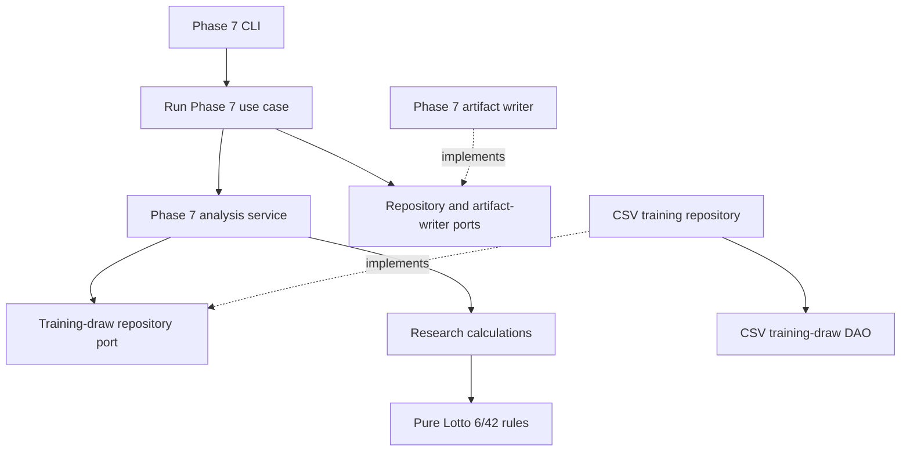

<!-- @codebase_provenance_JEO -->
# Repository architecture

This change organizes existing research code and gives the Phase 7 train-only analysis a small, usable `src` package. It does not add Phase 8 application behavior, a collector, a web client, a prediction method, or an external-source integration.

## Layer responsibilities

| Layer | Current responsibility | Implemented modules |
|---|---|---|
| Domain | Validate Lotto 6/42 combinations and encode unordered draws | `magic_lotto.domain.draw_642` |
| Application ports | Define the training-draw and artifact-writer contracts consumed by the Phase 7 use case | `magic_lotto.application.ports` |
| Application services and use cases | Load the established training partition through a repository contract, run the existing analysis, and request existing outputs | `magic_lotto.application.services.phase7_analysis_service`, `magic_lotto.application.use_cases.run_phase7` |
| Research | Hold the existing K-means, PCA, fair-null, and descriptive calculations | `magic_lotto.research.kmeans_642` |
| Infrastructure | Read the fixed CSV prefix, implement the repository contract, and serialize the existing charts and reports | `magic_lotto.infrastructure.dao`, `magic_lotto.infrastructure.repositories`, `magic_lotto.infrastructure.serialization` |
| Interfaces | Wire the Phase 7 CLI and provide notebook startup helpers | `magic_lotto.interfaces` |
| Historical research | Preserve Phase 3 Monte Carlo code away from the current application package | `research/legacy/scripts/monte_carlo_baseline.py` |

`src/magic_lotto/infrastructure/sources/` is intentionally absent. No source adapter has an approved operational consumer, and this change does not implement collection. A source adapter can be introduced only with a separately approved collection scope.

## Dependency direction



Infrastructure and interface modules are the composition boundary. Domain code does not import filesystem, network, database, framework, or UI modules. The repository contract exists because the analysis service consumes it; the CSV DAO and repository are concrete local-file adapters.

## Directory layout

```text
Magic_Lotto/
├── data/
│   ├── analysis/phase2/        Existing Phase 2 tables
│   ├── features/               Existing protected Phase 4 artifacts
│   ├── processed/              Existing normalized datasets
│   └── raw/                    Existing source files
├── docs/
│   ├── architecture/           Architecture and migration policy
│   └── research/               Historical Phase 1 through Phase 3 reports
├── models/                     Existing saved model settings
├── notebooks/                  Six existing notebooks
├── reports/                    Existing Phase 3 and later evidence
├── research/legacy/scripts/    Historical Phase 3 Monte Carlo script
├── scripts/                    Historical phase utilities and compatibility entrypoints
├── src/magic_lotto/
│   ├── application/            Phase 7 service, use case, and ports
│   ├── domain/                 Pure 6/42 combination rules
│   ├── infrastructure/         CSV DAO, repository, and artifact writer
│   ├── interfaces/             CLI and notebook bootstrap
│   ├── research/               Existing descriptive analysis calculations
│   └── paths.py                Repository root and exact legacy path map
└── tests/                      Phase 7 and notebook/path regression tests
```

The move map and byte hashes are in [the migration manifest](../REPOSITORY_LAYOUT_MIGRATION.json) and [the file migration guide](FILE_MIGRATION_MAP.md). `data/features/`, Phase 4 and later reports, and model settings remain at their original paths.

## Phase 7 data boundary

The CSV DAO reads at most the first 1,003 normalized records. It validates the established 902 training draws, dates `2016-08-30` through `2022-11-12`, unique `source_row` provenance values, valid draw status, and six distinct balls in range. `source_row` does not define chronology; `draw_date` does. Validation and locked-test suffix rows are not read. The source CSV is not rewritten or reordered.

The analysis calculations, fixed parameters, and descriptive interpretation are unchanged. The package split moves chart and report writing into infrastructure. No result from this work changes `STOP_NO_REPRODUCIBLE_PREDICTIVE_SIGNAL`.

## Packaging and entrypoints

Python 3.10 or newer is declared in `pyproject.toml`. Core numerical dependencies are NumPy, pandas, scikit-learn, and Matplotlib. The notebook extra adds IPython and nbformat. The Phase 7 console entrypoint is `magic-lotto-phase7`; `scripts/phase7_kmeans_642.py` remains a compatibility shim for existing commands and imports.

Install the checkout and notebook requirements with:

```bash
python -m pip install -e ".[notebook]"
```

Run the train-only analysis with:

```bash
magic-lotto-phase7 --null-replicates 100 --seed 162
```
