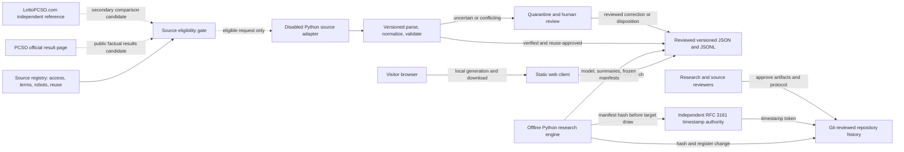
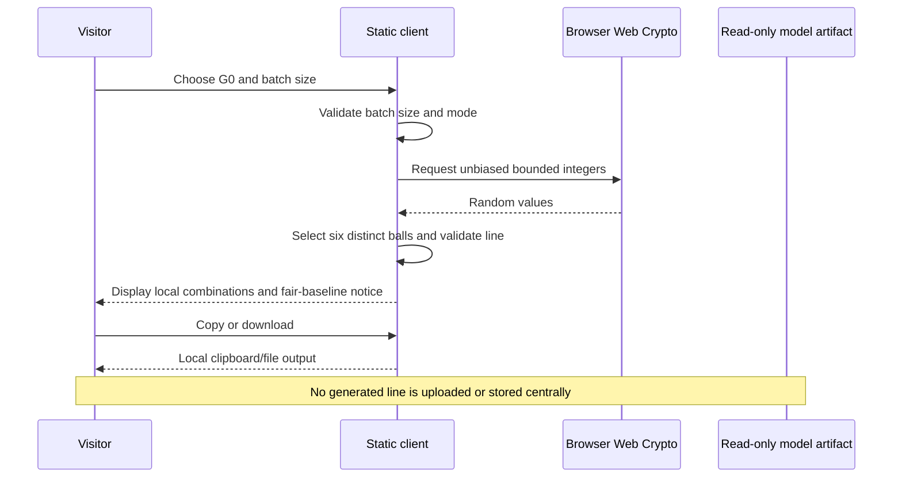
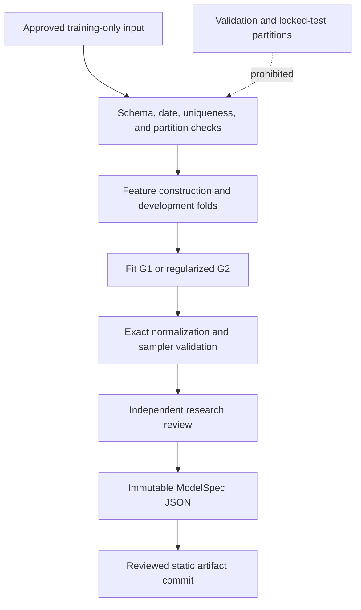

# Application and Data Flow
<!-- @codebase_provenance_JEO -->

- **Status:** Proposed component and workflow design; not implemented
- **Baseline:** `origin/main` at `b67e31572187001c89266839871c9e28456b90e8`
- **Last reviewed:** 2026-10-17
- **Research verdict:** `STOP_NO_REPRODUCIBLE_PREDICTIVE_SIGNAL`

**Scope:** Philippine Lotto 6/42 only. 3D Lotto, other lottery games, and unrelated prediction systems are outside this design.

## System context diagram



Dashed source flow is design-only and disabled by default. PCSO is the authoritative source candidate; LottoPCSO.com is a secondary independent reference and cannot confer official verification without PCSO cross-check. Source eligibility includes current terms, robots rules, ordinary access conditions, applicable reuse limits, pacing, and review expiry. Public visibility is not permission. The visitor's generated combinations do not flow to the repository, a collector, or a service.

## Major components and responsibilities

| Component | ID | Responsibility | State boundary |
| --- | --- | --- | --- |
| Python research core | C1 | Validate approved training data, fit versioned models, calculate exact probabilities, emit artifacts | Offline; training-only until a separate prospective evaluation is approved |
| Artifact repository | C2 | Store versioned JSON/JSONL, hashes, manifest and evaluation events | Git-reviewed; immutable records use new versions/events rather than replacement |
| Static web client | C3 | Read approved artifacts, run local generation, display explanations, export visitor output | Browser-local; no central write endpoint |
| Public registry view | C4 | Render frozen project-generated research manifests as static read-only pages | Publishes only after pre-draw timestamp evidence is verified |
| Evaluation process | C5 | Apply frozen metrics to authorized post-registration outcomes | Append-only result event; cannot tune registered models in place |
| Source adapter boundary | C6 | Check source eligibility; define ordinary retrieval, versioned parsing, normalization, deduplication, independent cross-check, quarantine, and correction flow | Disabled until current source-specific access/reuse review and human feasibility approval |
| Independent timestamp service | C7 | Timestamp the canonical manifest hash before the target draw | External evidence; token and verification details retained |

## User journeys for G0, G1, and G2

### G0: uniform fair-random default

1. Visitor opens the static site; G0 is selected and its equal-probability explanation is visible.
2. Browser confirms Web Crypto availability. Failure produces an explicit error without insecure fallback.
3. Visitor chooses a valid batch size. The browser samples six distinct balls per line without replacement, while complete lines are independent by default.
4. The UI displays sorted lines and optional descriptive summaries. It does not imply that a line is more likely to win.
5. Visitor copies or downloads the output locally. No request containing the generated numbers is made.

### G1: historical-weighting control

1. Visitor chooses an experimental mode after reading its label.
2. The client validates model schema/version and checks training cutoff, status metadata, and the approved `TEST-005` concentration-guardrail evidence.
3. The browser samples from the fixed-cardinality distribution defined by the published positive weights and normalizer.
4. The output shows the exact model version and “experimental control” status. No superior-odds statement is made.

### G2: calibrated soft constraints

1. UI exposes G2 only after its model status is `approved_for_experimental_use` and `TEST-006`, `TEST-007`, `TEST-013`, and `TEST-021` pass at the reviewed artifact revision.
2. Browser validates the versioned feature definition and parameter artifact.
3. The exact DP sampler produces a line from the normalized positive-support distribution.
4. UI names the soft features and reports that matching historical structure does not establish future advantage.
5. If integrity, parity, or compute limits fail, G2 is unavailable and the reason is shown.

## Browser-local generation and download workflow



For G1/G2 only, the client first reads the approved static model artifact. Model artifact fetches contain no visitor line. If downloads are supported, use explicit UTF-8 CSV or JSON with a safe filename and a note that records were generated locally. No account or server acknowledgement is required.

## Historical results exploration

The frontend reads only public result artifacts whose source review is approved and whose record-level verification state is visible. It can filter by game/date and present counts, but every chart must show its source, time span, missing-data status, and that historical frequencies do not imply predictive value. A correction does not overwrite an observation; the UI shows the corrected state and links to its correction event. If source reuse is not approved, hide the dataset and show a source-status notice instead of copying results into the app.

## Probability calculation and display

```mermaid
flowchart LR
  Fair[Fair independent Lotto 6/42 assumption] --> Exact[1 / C(42,6) = 1 / 5,245,786]
  Model[G1/G2 model artifact] --> Normalize[Validate target distribution and normalizer]
  Normalize -->|validated| ModelP[Model selection probability P_model(S)]
  Normalize -->|not validated| NA[Not calculated / Not established]
  Train[Approved 902-draw training sample] --> Feature[Versioned feature definition and count]
  Feature --> Frequency[Historical frequency count / N]
  Exact --> Labels[Display as separate labelled measures]
  ModelP --> Labels
  NA --> Labels
  Frequency --> Labels
```

The fair-draw value is the chance that the draw exactly matches one specified line; every valid line has the same value under the fair independent model. A model-selection probability describes the named generator's normalized output distribution and is not the chance of winning. A historical frequency describes a stated sample and pattern definition only. Historical displays include the dataset count, date range, data/model version, and feature definition; unavailable quantities show “Not calculated” or “Not established.” None of these displays authorizes predictive claims.

## Offline Python model-building workflow



The existing training boundary is 902 draws dated 2016-08-30 through 2022-11-12. The Phase 7 report says `source_row` is a unique provenance identifier, not chronological order; order is derived from validated `draw_date`. Model development cannot inspect validation or locked-test records. Chronological folds within approved training data may be used for fitting choices and stability checks, with all feature selection and multiplicity decisions recorded.

## Model approval and static artifact publication

The model builder emits immutable `ModelSpec` JSON and an audit report. Reviewers verify data hash/cutoff, fitting code revision, feature definitions, normalization, sampler fidelity, calibration, and release label. A reviewed commit publishes the artifact for read-only consumption. A rollback means republishing a known prior approved artifact reference or withdrawing visibility; it does not rewrite the model's history. G2 remains hidden if any required evidence is missing.

## Prospective batch registration and freeze

```mermaid
sequenceDiagram
  participant R as Research maintainer
  participant E as Offline engine
  participant G as Git-reviewed artifact store
  participant T as RFC 3161 TSA
  participant S as Static registry
  participant D as Future draw source

  R->>E: Freeze protocol, models, target draw, and metrics
  E->>E: Generate project research batches; canonicalize manifest
  E->>E: Hash manifest and verify referenced artifact hashes
  E->>T: Submit hash before target draw
  T-->>E: Signed timestamp token and verification data
  E->>G: Commit frozen manifest, token, and audit metadata
  G-->>S: Publish read-only registry artifact under deployment policy
  D-->>E: Outcome only after draw and source review
  E->>G: Append EvaluationEvent under frozen protocol
```

GitHub Pages and Cloudflare Pages are static hosting candidates, but static hosting does not provide a visitor write endpoint. Registration is a controlled maintainer workflow, not an in-browser submission. The trusted timestamp binds a canonical hash to a time; it does not prove the manifest's truth or quality. A public registry can be updated after the timestamp is secured; delayed deployment does not backdate the browser publication. The timestamp and pre-draw manifest are the evidence of registration time.

`StudyManifest` freezes the study ID and version, target draw/time zone, models/config hashes, output batch hashes and lines, generator modes, primary and secondary metrics, comparison plan, multiple-comparison correction, outcome-source plan, and stopping rule. Any material change creates a superseding manifest before outcomes, with the prior version retained. The pre-draw state must be externally timestamped. Git commit time alone is not sufficient.

## Post-draw evaluation workflow

After a target draw, the evaluator first verifies the manifest hash and timestamp token, then obtains a separately authorized and verified observation. It computes predeclared metrics only. It appends an immutable `EvaluationEvent` with the outcome observation ID, exact manifest hash, metric version, and execution revision. Corrections append new linked events and never erase original scores. Registered batches are not retuned after outcomes. The existing validation and locked-test records are outside this workflow.

A future confirmatory evaluation should declare a primary proper score, such as the paired difference in full-combination log score against G0, before any target draw. Match counts, jackpot hits, diversity, and distribution fidelity are separate secondary/descriptive endpoints. Correct for multiplicity and report uncertainty. A 50-draw operational pilot is not a confirmatory test without a formal power analysis.

## Separately gated official collector workflow

The collector remains disabled and design-only. The Python DrawSourceAdapter operations are check_access_conditions, health_check, fetch_draws, parse_response, normalize_records, and report_source_status. A disabled adapter and its health check make no network requests. Before any live pilot, a human-reviewed feasibility report must record source identity, current terms and robots findings, permitted ordinary request method, reuse scope, pacing, error/denial behavior, review owner, and expiry. Written permission is required only when applicable law, terms, or a source-specific restriction requires it; no blanket permission prerequisite is asserted.

The proposed pipeline is: source eligibility; ordinary permitted public retrieval; source-specific HTML or structured-response parsing under a versioned parser; date and number normalization; exact game/date/combination validation for Lotto 6/42; stable deduplication; independent cross-verification; quarantine of incomplete, malformed, conflicting, or unverified records; versioned storage with source/payload/parser/revision provenance; then downstream use only for authorized post-registration outcomes. Missing source values remain null. No records are repaired by guessing, and no original dataset is edited or reordered.

PCSO's public result page currently exposes start/end date fields, a game selector, and a mixed-game result table. Whether an ordinary GET or POST request, hidden ASP.NET WebForms state, pagination, or historical date filters are usable remains unverified. LottoPCSO.com has a 6/42 history table and its disclaimer directs users to PCSO for verification while identifying the site as unaffiliated; it is secondary and requires its own current terms, robots, and reuse review. LottoMatik remains excluded from automation based on the prior documented restriction; its current terms were not reverified here. FOI is not a collection dependency. See the current matrix in [05 Backend and Data Schema](05_BACKEND_AND_DATA_SCHEMA.md).

Parser feasibility testing is offline and synthetic. Fixtures cover date formats, published versus sorted order, missing fields, duplicate rows, incomplete combinations, unexpected headers, placeholders, malformed markup, pagination/date filters, markup changes, access denial, timeout/server failure, cross-source conflicts, and official corrections. The implementation language remains Python. requests or httpx, the standard-library HTML parser, BeautifulSoup4, lxml, Pandas, and Pydantic/JSON Schema are evaluation candidates only; no new dependency is approved. Do not run scraping, live network tests, or collector activation as part of this design.

If later approved, collection should run at low frequency after result publication, with the current official draw timetable verified before a schedule is selected. Request pacing and bounded retries must follow current source conditions; stop on access denial, clear prohibition, or unresolved restrictions. Do not use CAPTCHA solving, stealth browsers, proxy rotation, or WAF circumvention. A scheduled workflow is not exact timestamp evidence.

## Failure and recovery scenarios

| Failure | Required behavior |
| --- | --- |
| Browser lacks Web Crypto | Disable generation with a clear compatibility message; no `Math.random` fallback |
| Invalid input or artifact | Reject with field/record-level error; do not coerce or partially publish |
| Model hash/schema mismatch | Hide that model and preserve G0 if its independent code and inputs remain valid |
| Timestamp request fails | Do not mark batch frozen/registered; retain draft locally and retry only before target draw |
| Timestamp token verification fails | Quarantine manifest and stop evaluation/publication as registered evidence |
| Target draw source unavailable | Record missing observation as pending; do not invent an outcome or alter protocol |
| Conflicting official records | Quarantine both candidates and require review; append correction event if resolved |
| Static deployment delayed | Keep timestamp proof and registry state separate; show publication status and actual registry deployment time when available |
| Source permission expires or changes | Disable adapter and new reuse; retain provenance and obtain policy review for prior artifacts |

## Trust boundaries and data movement

1. **Visitor browser:** transient generated lines and downloaded output. Visitor data do not cross the browser boundary by application design.
2. **Static host/CDN:** serves public app/artifacts and may receive request metadata. Provider-specific logging and privacy terms require review.
3. **Research repository:** versioned models, synthetic schema fixtures, public approved summaries, and frozen research artifacts. Do not store visitor data or secret credentials.
4. **Training-data boundary:** allowlisted 902-record training inputs; protected validation and locked-test paths remain inaccessible.
5. **External source boundary:** no collection until source and reuse approvals. External observations can be wrong, delayed, or corrected.
6. **Timestamp authority:** receives the manifest hash, not lottery data needed to disclose private information; verify token identity, policy, imprint, time, and signature.
7. **Human review boundary:** reviewers approve source reuse, model release, registration protocol, and deployment separately.

## Requirements traceability

| Requirement group | Component(s) | Planned verification | Milestone |
| --- | --- | --- | --- |
| FR-001, FR-002, NFR-005 | C3 | TEST-001, TEST-003, TEST-021 | 8C |
| FR-003, FR-009 | C1, C2, C3 | TEST-005, TEST-012 | 8B, 8C |
| FR-004 | C1, C2, C3 | TEST-006, TEST-007, TEST-013 | 8B, 8C |
| FR-005, FR-006 | C1, C3 | TEST-002, TEST-004 | 8A, 8C |
| FR-007, FR-015, FR-016, NFR-003 | C3, C5 | TEST-014, TEST-019 | 8B, 8C, 8F |
| FR-008, FR-017 | C2, C3, C6 | TEST-008, TEST-015, TEST-020, TEST-024 | 8C, 8D |
| FR-010, NFR-001 | C3 | TEST-016 | 8C |
| FR-011 | C2, C4, C7 | TEST-011, TEST-017 | 8E |
| FR-012 | C5, C7 | TEST-018, TEST-019 | 8F |
| FR-013 | C6 | TEST-010, TEST-020 | 8D |
| FR-014 | C1, C2, C3, C6 | TEST-023 | 8A, 8C, 8D |
| TR-013, DATA-016, DATA-017 | C2, C6 | TEST-008, TEST-015, TEST-020, TEST-024 | 8D |
| TR-014, DATA-018 | C1, C2, C3 | TEST-008, TEST-014 | 8A, 8C |
| DATA-015 | C1, C2, C5, C6 | TEST-009, TEST-018, TEST-023 | 8A, 8D, 8F |
| NFR-002, NFR-006, NFR-007 | C3, C2 | TEST-008, TEST-021 and measured performance review | 8B, 8C |
| NFR-004, NFR-008 | C1, C2, C3 | TEST-008, TEST-009, TEST-011 | 8A, 8B, 8E |

Status in this matrix is planned only. No Phase 8 implementation or test result is asserted.
