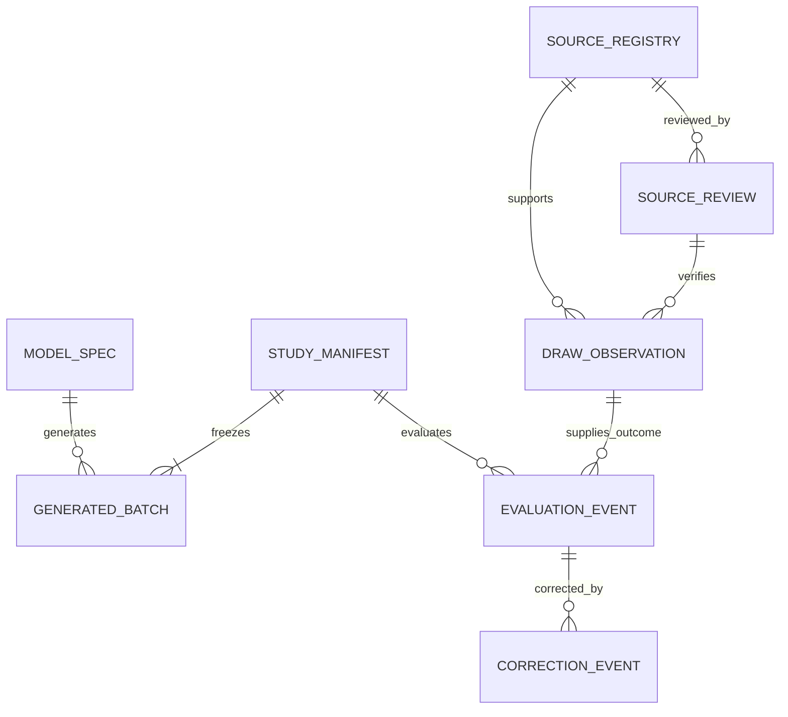

# Backend, Storage and Data Schema
<!-- @codebase_provenance_JEO -->

- **Status:** Proposed artifact schema and lifecycle; no database or backend is implemented
- **Baseline:** `origin/main` at `998f16d133b4500dfd65fa57fb73f9d84c91f8f4` (merged PR #4)
- **Last reviewed:** 2026-10-17
- **Research verdict:** `STOP_NO_REPRODUCIBLE_PREDICTIVE_SIGNAL`

**Scope:** Philippine Lotto 6/42 only. Draw records and source adapters for 3D Lotto, other lottery games, or unrelated prediction systems are excluded.

## Storage requirements and rationale

V1 uses versioned JSON for structured snapshots and JSONL for append-only event streams, reviewed through Git. This matches the proposed offline research engine and static read-only client without adding a service or database. The repository stores only public/approved research artifacts and synthetic fixtures; it does not store visitor-generated combinations.

The merged repository currently has Phase 7-specific CSV input and report output: `CsvTrainingDrawDao` and `CsvTrainingDrawRepository` read the established training prefix, while the infrastructure `Phase7ArtifactWriter` writes the existing charts, `summary.json`, and `README.md` under `reports/phase7_kmeans_642/`. The application ports `TrainingDrawRepository` and `Phase7ArtifactWriter` are contracts for that Phase 7 workflow, not general draw-observation or artifact-store interfaces. There is no Phase 8 JSON/JSONL store, database, source adapter, or static registry.

| Store | Advantages | Limits | V1 decision |
| --- | --- | --- | --- |
| Git-versioned JSON/JSONL | Human review, diffs, immutable commit history, no database service, static hosting compatible | Concurrent writers require repository review; large histories are cumbersome; Git is not a query service | Use for bounded public artifacts and frozen studies |
| SQLite | Transactional local workflows and queries | Not a shared write store for a static site; adds migration/backup lifecycle | Defer unless local research operations show a need |
| PostgreSQL or managed database | Concurrent writes, query/index support, service controls | Requires backend/API, identity/access policy, operations, privacy and cost decisions | Out of v1; separate architecture approval required |

No database is required for browser-local generation or read-only artifact viewing. Preserve the existing application-port to infrastructure implementation direction when a concrete Phase 8 use case needs storage. Add a narrow application port and matching infrastructure serializer/repository only for that approved consumer; do not broaden the Phase 7 training port or writer or create a generic abstraction without a caller. The Phase 8 operations previously listed as `read_model`, `read_draw_series`, `write_frozen_manifest`, and `append_event` remain logical proposals, not implemented methods.

## JSON and JSONL storage strategy

- Store each approved snapshot as UTF-8 JSON with a schema version and stable ID.
- Store immutable evaluation and correction events as one JSON object per JSONL line.
- Canonical hash input uses UTF-8, sorted object keys, normalized UTC timestamps, and no insignificant whitespace; line arrays use ascending ball order. Each object's own digest field is omitted from its hash preimage. For `StudyManifest`, the preimage is the complete frozen protocol and its model/batch references with only `manifest_sha256` and `timestamp_evidence` omitted; the TSA response is detached evidence that references this digest. `GeneratedBatch.batch_sha256` is computed with `batch_sha256` omitted.
- Record SHA-256 for source snapshots, model artifacts, generated batch files, and frozen study manifests.
- Do not update a frozen artifact in place. Create a new version/event referencing the previous ID and hash.
- Keep source data, synthetic fixtures, public display artifacts, and future outcomes in separate directories and access paths.
- If separately approved, use `models/phase8/` for versioned Phase 8 model parameters/specifications, `reports/phase8/` for reviewed public research artifacts and frozen registry manifests, and `data/prospective/lotto-6-42/` for post-cutoff source observations/outcomes. These are proposed new locations, not current files or directories. Keep the protected 902-draw training source at `data/processed/lotto_6_42_cleaned_normalized.csv`; never merge prospective records into it or the sealed partitions.
- Do not put credentials, visitor data, browser-local lines, or unapproved source extracts in Git.

## Logical entities and relationships



`SOURCE_REGISTRY` identifies a candidate source. `SOURCE_REVIEW` records separate access, reuse, privacy, and provenance decisions. `DRAW_OBSERVATION` is a normalized source record. `MODEL_SPEC` is immutable model/configuration metadata. `STUDY_MANIFEST` freezes a protocol and generated batches before a draw. `GENERATED_BATCH` is research-owned output, not visitor output. `EVALUATION_EVENT` is appended after the target draw. `CORRECTION_EVENT` and quarantine records preserve history.

## Stable requirements

| ID | Data requirement |
| --- | --- |
| DATA-001 | Every persisted record shall declare `schema_version`, `record_type`, and stable record ID. |
| DATA-002 | Source, model, study, batch, and event identifiers shall remain stable across corrections; changed facts create linked records/events. |
| DATA-003 | A verified `DrawObservation` shall have exactly six distinct integers from 1 through 42, one game, a validated draw date, and source evidence. |
| DATA-004 | Source access and reuse decisions shall be separate, reviewable, dated, and capable of expiry/revocation; collectors default disabled. |
| DATA-005 | `ModelSpec` shall bind algorithm, version, feature definition, training hash/cutoff, parameters, and fitting revision. |
| DATA-006 | `StudyManifest` shall freeze model/config hashes, registered output, target draw, endpoint definitions, and analysis plan before outcomes. |
| DATA-007 | `GeneratedBatch` shall identify research mode, model version, sample design, complete line set, and manifest. |
| DATA-008 | `EvaluationEvent` shall reference one frozen manifest and verified outcome source; it shall be append-only. |
| DATA-009 | Missing or unknown source values shall be JSON `null`, never fabricated, guessed, or encoded as empty strings or zero. |
| DATA-010 | Provenance shall identify source URLs/retrieval time/snapshot hash and reviewer status without claiming unverified authority. |
| DATA-011 | Historical training and future prospective outcomes shall use separate datasets and access controls; sealed validation/test data remain inaccessible. |
| DATA-012 | Quarantine and correction shall preserve the original record, reason, reviewer role, and successor reference. |
| DATA-013 | Frozen hashes shall cover canonical serialized bytes; RFC 3161 token and verification evidence shall bind to the manifest hash. |
| DATA-014 | No visitor-generated combination or profile shall be persisted centrally in v1. |
| DATA-015 | Phase 8 draw records shall use game ID lotto-6-42 only; post-cutoff observations remain in a separate prospective store and never modify the 902-draw training source or sealed partitions. |
| DATA-016 | Draw provenance shall include source classification and identity, retrieval time, parser version, payload hash when allowed, access/reuse review states, record revision, and supersession links. |
| DATA-017 | Source access and reuse reviews shall be separate, current, conditional on applicable restrictions, and fail closed; written permission is required only where law, terms, or source-specific conditions require it. |
| DATA-018 | Probability metadata shall identify fair-draw probability, model-selection probability, or historical pattern frequency and include the applicable model/data/feature version and denominator. |

## Schema conventions

- Dates use ISO 8601 calendar date (`YYYY-MM-DD`); instants use UTC RFC 3339 (`YYYY-MM-DDThh:mm:ssZ`).
- Canonical ball arrays contain six distinct integer values sorted ascending as winning_numbers_sorted. Preserve the source-published order separately when the source supplies it.
- Monetary values, if later included, use decimal strings plus currency codes; do not store floating-point currency.
- Unknown source fields use `null`. Empty string means a known empty text value only when the source explicitly provides it.
- `verification_status`, `access_review_status`, and `reuse_review_status` are independent; a source may be official while automated access or reuse remains unreviewed or disallowed.
- Personal data are excluded by design. Reviewer identity uses a project role or approved reviewer ID; do not add personal details without a separate governance decision.

## DrawObservation schema

Required fields: `schema_version`, `record_type`, `record_id`, `record_class`, `game_id`, `draw_date`, `winning_numbers_sorted`, `published_combination`, `source_id`, `source_url`, `source_classification`, `retrieved_at`, `parser_version`, `payload_sha256`, `verification_status`, `access_review_status`, `reuse_review_status`, `record_revision`, `supersedes_record_id`, `source_refs`, and `created_at`. Optional fields include jackpot amount/currency, winner count, source draw ID and publication timestamp, source snapshot reference, and cross-verified source IDs. A required field may be null only where the field rules below explicitly allow it.

`record_class` is `public_observation` or `synthetic_fixture`; `game_id` is always `lotto-6-42`. `winning_numbers_sorted` is the canonical ascending six-number set. `published_combination` preserves the source's visible order when present and is null when unavailable. `payload_sha256` is null if no payload was retrieved or if retaining/hash recording is not allowed by the reviewed source conditions. Verification states distinguish provisional, pending cross-check, verified official, verified third-party cross-check, quarantined, superseded, and synthetic. Only an appropriately verified observation with approved source-specific reuse status may appear in a results view or authorized outcome evaluation.

## SourceRegistry, SourceReview, and provenance records

`SourceRegistry` is proposed at schema version 2.0. Its fields are `source_id`, `schema_version`, `publisher_name`, `source_name`, `source_url`, `source_classification` (`official`, `third_party`, or `unverified`), `priority`, `terms_url`, `robots_url`, `access_review_status`, `reuse_review_status`, `reviewed_request_method`, `request_limits`, `review_conditions`, `last_reviewed_at`, `review_expires_at`, `collector_enabled`, and notes. Review states are `not_reviewed`, `review_required`, `conditional`, `approved`, `denied`, or `expired`. The exact conditions field records when applicable law, terms, or source-specific restrictions require written permission; written permission is not a blanket prerequisite. `collector_enabled` defaults to `false`; changing it requires separate activation approval. Official classification does not imply access or reuse approval.

No source adapter or `src/magic_lotto/infrastructure/sources/` package exists in the current repository; the architecture guide explicitly records it as absent. The Phase 7 CSV DAO is bound to the existing train-only input contract and must not be extended to fetch public results. Any future adapter, parser, or separate observation persistence requires implementation approval and remains disabled until source review passes.

`SourceReview` fields: `source_review_id`, `source_id`, `review_scope` (`identity`, `access`, `reuse`, `privacy`, or `provenance`), `decision` (`pending`, `approved`, `denied`, `expired`, or `needs_review`), `reviewed_at`, `reviewer_role`, `evidence_refs`, `conditions`, and nullable `expires_at`. Access and reuse require separate decisions; each must be rechecked when a source changes its terms or access behavior.

Provenance references include primary `source_id`, `source_url`, `source_classification`, `retrieved_at`, parser version, nullable payload hash, nullable source publication time, optional snapshot hash/locator, review IDs, and cross-verification references. Preserve raw source evidence only where current review allows it; otherwise keep approved metadata and a source URL without copying page content. FOI is excluded as an operational acquisition dependency.

## ModelSpec schema

Required fields: `schema_version`, `record_type`, `model_id`, `model_version`, `algorithm_id` (`G0`, `G1`, `G2`), `status` (`baseline`, `experimental_control`, `pending_calibration`, `approved_for_experimental_use`, or `retired`), `feature_definition_version`, `training_dataset_sha256` or `null` for G0, `training_cutoff` or `null` for G0, `fit_revision`, `parameter_artifact_sha256`, `normalizer`, `sampler_contract_version`, `created_at`, and `review_refs`. Optional `probability_disclosure_refs` link typed probability metadata to this model version. G2 includes calibration method, regularization configuration, chronological fold definition, and approval status. G1 includes smoothing configuration and fixed-cardinality normalizer version. Released G1/G2 `review_refs` must include evidence that the concentration diagnostic and threshold were approved before fitting and passed. No unapproved parameters belong in a released model artifact.

## StudyManifest schema

Required fields: `schema_version`, `record_type`, `study_id`, `manifest_version`, `status`, `target_game_id`, `target_draw_date`, `target_draw_at_utc`, `target_draw_time_zone`, `frozen_at`, `protocol_version`, `model_refs`, `batch_refs`, `primary_endpoint`, `secondary_endpoints`, `multiplicity_policy`, `power_analysis_ref`, `stopping_rule`, `outcome_source_review_id`, `manifest_sha256`, `timestamp_evidence`, `created_at`, and `supersedes_manifest_id` (nullable). `target_game_id` must be `lotto-6-42`. In `draft`, target time, freeze time, digest, timestamp evidence, and outcome-source review may be null; a non-confirmatory operations-only pilot may have a null power-analysis reference. Freezing requires a confirmed target UTC instant, nonempty model and batch references, a canonical digest, and a defined protocol. A confirmatory manifest also requires approved outcome-source review and a completed power/sensitivity reference. `timestamp_evidence` remains null until a verified TSA response is attached. `timestamp_evidence` identifies RFC 3161 TSA, token file/hash, verified imprint, token time, policy, signature status, and verifier/tool version. Registration is complete only after the token verifies and precedes `target_draw_at_utc`; static publication is a later state.

Lifecycle: `draft` → `frozen` → `timestamped` → `published` → `awaiting_outcome` → `evaluated`. `quarantined`, `withdrawn`, and `superseded` are terminal/non-editing states with a reference to the reason or successor. `frozen` has a canonical manifest hash but no timestamp token; `timestamped` requires a verified token. If the target draw is rescheduled before it occurs, do not silently edit the frozen manifest: create and timestamp a superseding manifest before the new target event. The external timestamp establishes time evidence for a hash, not validity of the model or data.

## GeneratedBatch schema

Required fields: `schema_version`, `record_type`, `batch_id`, `study_id`, `manifest_version`, `algorithm_id`, `model_version`, `config_sha256`, `sampling_mode` (`independent_with_replacement` or `distinct_sets`), `line_count`, `ticket_lines`, `generated_at`, `training_cutoff`, `software_revision`, `batch_sha256`, and `record_class` (`research_batch` or `synthetic_fixture`). `training_cutoff` is nullable for G0. `ticket_lines` is an array of `line_count` sorted six-integer lines; repeated complete lines are permitted only for `independent_with_replacement`. Lines are research-owned and only committed as part of a pre-draw frozen manifest. Visitor-generated lines are not `GeneratedBatch` records and are not uploaded.

## EvaluationEvent schema

Required fields: `schema_version`, `record_type`, `evaluation_event_id`, `study_id`, `manifest_version`, `manifest_sha256`, `target_draw_observation_id`, `evaluation_revision`, `metric_version`, `metrics`, `executed_at`, `software_revision`, and `event_status`. `metrics` distinguishes per-line match counts, full-combination hit indicator, log score, aggregate distribution metrics, and uncertainty summaries; only endpoints frozen in the manifest may be confirmatory. Missing observations remain pending; they are not replaced with guessed values.

## ProbabilityDisclosure schema

Required fields: `schema_version`, `record_type`, `record_id`, `measure_type`, `status`, `value_exact`, `percentage`, and `evidence_refs`. `measure_type` is `fair_draw_probability`, `model_selection_probability`, or `historical_pattern_frequency`. `status` is `calculated`, `not_calculated`, or `not_established`; unavailable values are null.

For fair-draw probability, record the fair-independent-draw assumption, numerator 1, denominator 5,245,786, and display percentage 0.00001906% (approximately). For model-selection probability, include model ID/version, algorithm ID, normalizer reference, normalization and sampler validation evidence, and feature-definition version. A numeric value is permitted only for a normalized and validated model distribution approved for experimental display; it describes generator selection, not the draw or win probability. For historical pattern frequency, record numerator/count, denominator/sample size, dataset hash/version, start/end dates, and feature-definition ID/version. The established training sample is 902 draws from 2016-08-30 to 2022-11-12; later observations use separate prospective evidence and cannot be silently combined with it.

## Field-level type and nullability constraints

The tables define the proposed JSON contracts at the field level. “Required” means the key is present; state-dependent `null` is explicitly described. Unknown source values use JSON `null`.

### DrawObservation

| Field | JSON type | Constraint |
| --- | --- | --- |
| `schema_version`, `record_id`, `game_id` | string | Required; proposed DrawObservation schema version 2.0; game ID must be `lotto-6-42` |
| `record_type` | string | Literal `DrawObservation` |
| `record_class` | string | `public_observation` or `synthetic_fixture` |
| `draw_date` | string | ISO date `YYYY-MM-DD`; verified only after source review |
| `winning_numbers_sorted` | integer array | Exactly 6 distinct values in 1..42, ascending canonical order |
| `published_combination` | integer array or null | Six distinct source-displayed values in published order; null if not supplied or unknown |
| `source_id`, `source_url` | string or null | Required for public records; null only for synthetic/offline fixtures |
| `source_classification` | string | `official`, `third_party`, or `unverified`; classification does not imply access/reuse approval |
| `retrieved_at` | string or null | UTC RFC 3339; null only for synthetic/offline fixture |
| `parser_version` | string | Required parser/normalization contract version; fixture-specific for synthetic records |
| `payload_sha256` | string or null | Lowercase SHA-256 of retrieved bytes when allowed and available; null for synthetic/no payload or when review conditions do not allow recording |
| `verification_status` | string | `provisional`, `pending_cross_check`, `verified_official`, `verified_third_party_cross_checked`, `quarantined`, `superseded`, or `synthetic` |
| `access_review_status`, `reuse_review_status` | string | Each uses `not_reviewed`, `review_required`, `conditional`, `approved`, `denied`, or `expired` |
| `record_revision` | integer | Positive revision number; first accepted observation is 1 |
| `supersedes_record_id` | string or null | Stable ID of prior revision; null for an initial record |
| `cross_verified_source_ids` | string array | Optional source IDs used for independent cross-verification |
| `jackpot_amount`, `jackpot_currency` | string or null | Decimal amount and source currency; null when absent or unknown |
| `jackpot_winner_count` | integer or null | Nonnegative source value; null when absent, never inferred |
| `source_draw_id`, `source_published_at` | string or null | Source identifier and UTC RFC 3339 instant when provided |
| `source_refs` | array of objects | Empty only for synthetic fixtures; public records require provenance reference(s) |
| `created_at` | string | UTC RFC 3339 record-creation instant |

Each `source_refs` object records source ID/URL/classification, retrieval time, nullable publication time, nullable payload/snapshot hash and locator, review IDs, and whether that source independently verified the normalized draw. A source snapshot hash is null when recording it is unavailable or not allowed; never copy source content solely to populate a provenance field.

### SourceRegistry and SourceReview

| Field | JSON type | Constraint |
| --- | --- | --- |
| `source_id`, `source_review_id` | string | Stable IDs; present on their respective records |
| `schema_version` | string | Required on each record |
| `record_type` | string | Literal `SourceRegistry` or `SourceReview` |
| `publisher_name`, `source_name`, `source_url` | string | Required; identity claims remain reviewable |
| `source_classification` | string | `official`, `third_party`, or `unverified`; does not imply access/reuse approval |
| `priority` | string | `primary`, `secondary`, or `excluded_from_automation` |
| `access_review_status`, `reuse_review_status` | string | Each uses `not_reviewed`, `review_required`, `conditional`, `approved`, `denied`, or `expired` |
| `terms_url`, `robots_url` | string or null | Null only when no URL has been identified; review status remains separate |
| `reviewed_request_method`, `request_limits` | string/object or null | Current ordinary method and pacing/limits; null until reviewed |
| `collector_enabled` | boolean | Defaults to false; activation requires separate approval |
| `last_reviewed_at`, `review_expires_at` | string or null | UTC RFC 3339; null until source review occurs |
| `review_scope` | string | `identity`, `access`, `reuse`, `privacy`, or `provenance` |
| `decision` | string | `pending`, `approved`, `denied`, `expired`, or `needs_review` |
| `reviewed_at`, `expires_at` | string or null | UTC RFC 3339; `reviewed_at` null only while pending |
| `reviewer_role` | string | Role/approved reviewer ID; no personal profile fields |
| `evidence_refs`, `conditions` | arrays | Evidence references and explicit restrictions; empty for unreviewed record |

### ProbabilityDisclosure

| Field | JSON type | Constraint |
| --- | --- | --- |
| `record_id`, `schema_version` | string | Stable record ID and declared schema version |
| `record_type` | string | Literal `ProbabilityDisclosure` |
| `record_class` | string or null | Optional; use `synthetic_fixture` only for labelled synthetic examples |
| `measure_type` | string | `fair_draw_probability`, `model_selection_probability`, or `historical_pattern_frequency` |
| `status` | string | `calculated`, `not_calculated`, or `not_established`; unavailable numeric fields are null |
| `value_exact`, `percentage` | string or null | Exact fraction/decimal and display percentage; model values require a normalized, validated distribution |
| `numerator`, `denominator` | integer or null | Fair probability uses 1/5,245,786; historical frequency records count/N |
| `model_id`, `model_version`, `algorithm_id` | string or null | Required for model-selection probability; model is reviewed for experimental display |
| `normalizer_ref`, `normalization_status`, `sampler_validation_ref` | string or null | Model-selection probability requires validated normalization and sampler evidence |
| `dataset_sha256`, `dataset_count`, `date_start`, `date_end` | string/integer or null | Required for historical frequency; records source sample and interval |
| `feature_definition_id`, `feature_definition_version` | string or null | Required for historical pattern frequency and applicable model distributions |
| `assumption`, `evidence_refs` | string/array | Identifies fair-draw premise or model/data validation records |

### ModelSpec, StudyManifest, GeneratedBatch, and EvaluationEvent

| Field | JSON type | Constraint |
| --- | --- | --- |
| `model_id`, `model_version`, `feature_definition_version`, `fit_revision`, `sampler_contract_version` | string | Stable/model-version strings; G0 may use fixed contract IDs |
| `algorithm_id` | string | `G0`, `G1`, or `G2` |
| `status` | string | Model lifecycle enum defined above; G2 is not exposed while pending calibration |
| `training_dataset_sha256`, `training_cutoff` | string or null | Null for G0 and unfit candidates; required for a released trained model |
| `parameter_artifact_sha256` | string or null | Null for G0 or pending/unfitted candidate; required for released G1/G2 |
| `normalizer` | string or object | Versioned normalizer ID/config; synthetic placeholder only in synthetic fixture |
| `probability_disclosure_refs` | string array or null | Optional links to typed probability disclosure records for this immutable model version |
| `review_refs` | string array | Required; at least one approval reference for released G1/G2 |
| `study_id`, `batch_id`, `evaluation_event_id` | string | Stable IDs on respective records |
| `manifest_version`, `evaluation_revision`, `line_count` | integer | Positive integer; `line_count` equals `ticket_lines` length |
| `target_game_id`, `target_draw_date`, `target_draw_time_zone` | string | Game ID, ISO date, IANA time-zone name |
| `target_draw_at_utc`, `frozen_at` | string or null | RFC 3339 UTC; null only in draft state |
| `created_at`, `generated_at`, `executed_at` | string | RFC 3339 UTC; required for every non-draft research record |
| `protocol_version`, `primary_endpoint`, `metric_version`, `software_revision` | string | Immutable version/identifier references |
| `secondary_endpoints`, `model_refs`, `batch_refs` | arrays | Frozen, versioned references; batch/model arrays must be nonempty when frozen |
| `multiplicity_policy`, `stopping_rule` | string or object | Frozen, explicit protocol definitions |
| `power_analysis_ref`, `outcome_source_review_id` | string or null | Confirmatory manifest requires both resolved and approved |
| `manifest_sha256`, `config_sha256`, `batch_sha256` | string or null | Lowercase 64-hex SHA-256; null only before freeze/synthetic fixture |
| `timestamp_evidence` | object or null | Detached verified RFC 3161 evidence; required in timestamped and later states |
| `sampling_mode` | string | `independent_with_replacement` or `distinct_sets` |
| `ticket_lines` | array of integer arrays | Each line has six unique in-range ascending balls |
| `metrics` | object | Versioned named metrics; includes value, denominator/sample count, and uncertainty or explicit null where applicable |
| `event_status` | string | `pending_source`, `evaluated`, or `quarantined`; missing outcome remains pending |

### CorrectionEvent and QuarantineRecord

Both records include `schema_version`, `record_type`, stable event ID, `entity_type`, `entity_id`, `record_sha256`, `reason_code`, `evidence_refs` array, role attribution, and UTC `created_at`. `CorrectionEvent` additionally requires `successor_record_id`; `QuarantineRecord` requires `release_condition` and `disposition` (`open`, `released`, or `retained_quarantined`). No correction changes the prior object in place.

## Correction and quarantine records

`CorrectionEvent` is append-only and contains `schema_version`, `record_type`, `correction_event_id`, `entity_type`, `entity_id`, `prior_record_sha256`, `reason_code`, `evidence_refs`, `reviewer_role`, `created_at`, and `successor_record_id`. `QuarantineRecord` contains `schema_version`, `record_type`, `quarantine_id`, `entity_type`, `entity_id`, `record_sha256`, `reason_code`, `evidence_refs`, `detected_by_role`, `created_at`, `release_condition`, and `disposition` (`open`, `released`, or `retained_quarantined`). The original object remains retrievable and marked `superseded` or `quarantined`; no silent overwrite is permitted. Do not expose unsupported/uncertain observations as verified.

## Clearly labelled synthetic schema examples

Every example below is synthetic test data. It is not an official draw, actual registered batch, model result, timestamp proof, or experimental finding.

### Synthetic DrawObservation fixture

```json
{
  "schema_version": "2.0",
  "record_type": "DrawObservation",
  "record_id": "syn-draw-0001",
  "record_class": "synthetic_fixture",
  "game_id": "lotto-6-42",
  "draw_date": "2030-01-01",
  "winning_numbers_sorted": [2, 8, 14, 23, 31, 42],
  "published_combination": null,
  "source_id": null,
  "source_url": null,
  "source_classification": "unverified",
  "retrieved_at": null,
  "parser_version": "synthetic-fixture-v1",
  "payload_sha256": null,
  "verification_status": "synthetic",
  "access_review_status": "not_reviewed",
  "reuse_review_status": "not_reviewed",
  "record_revision": 1,
  "supersedes_record_id": null,
  "cross_verified_source_ids": [],
  "jackpot_amount": null,
  "jackpot_currency": null,
  "jackpot_winner_count": null,
  "source_draw_id": null,
  "source_published_at": null,
  "source_refs": [],
  "created_at": "2030-01-02T00:00:00Z"
}
```

### Synthetic ModelSpec fixture

```json
{
  "schema_version": "1.1",
  "record_type": "ModelSpec",
  "model_id": "syn-model-g2",
  "model_version": "0.0.0-synthetic",
  "algorithm_id": "G2",
  "status": "pending_calibration",
  "feature_definition_version": "synthetic-features-v1",
  "training_dataset_sha256": null,
  "training_cutoff": null,
  "fit_revision": "synthetic-fixture-only",
  "parameter_artifact_sha256": null,
  "normalizer": "synthetic-placeholder",
  "sampler_contract_version": "synthetic-v1",
  "probability_disclosure_refs": [],
  "created_at": "2030-01-02T00:00:00Z",
  "review_refs": []
}
```

### Synthetic ProbabilityDisclosure fixture

```json
{
  "schema_version": "1.0",
  "record_type": "ProbabilityDisclosure",
  "record_id": "syn-probability-fair-0001",
  "record_class": "synthetic_fixture",
  "measure_type": "fair_draw_probability",
  "status": "calculated",
  "value_exact": "1/5245786",
  "percentage": "0.00001906%",
  "numerator": 1,
  "denominator": 5245786,
  "model_id": null,
  "model_version": null,
  "algorithm_id": null,
  "normalizer_ref": null,
  "normalization_status": "not_applicable",
  "sampler_validation_ref": null,
  "dataset_sha256": null,
  "dataset_count": null,
  "date_start": null,
  "date_end": null,
  "feature_definition_id": null,
  "feature_definition_version": null,
  "assumption": "fair_independent_draw",
  "evidence_refs": ["synthetic-mathematical-contract"]
}
```

### Synthetic StudyManifest fixture

```json
{
  "schema_version": "1.0",
  "record_type": "StudyManifest",
  "study_id": "syn-study-0001",
  "manifest_version": 1,
  "status": "draft",
  "target_game_id": "lotto-6-42",
  "target_draw_date": "2030-02-01",
  "target_draw_at_utc": null,
  "target_draw_time_zone": "Asia/Manila",
  "frozen_at": null,
  "protocol_version": "synthetic-protocol-v1",
  "model_refs": [],
  "batch_refs": [],
  "primary_endpoint": "synthetic-only",
  "secondary_endpoints": [],
  "multiplicity_policy": "synthetic-only",
  "power_analysis_ref": null,
  "stopping_rule": "synthetic-only",
  "outcome_source_review_id": null,
  "manifest_sha256": null,
  "timestamp_evidence": null,
  "created_at": "2030-01-02T00:00:00Z",
  "supersedes_manifest_id": null,
  "record_class": "synthetic_fixture"
}
```

The examples intentionally use `null` for unknown source values and absent evidence. Their future dates and synthetic IDs are fixture markers, not actual records.

## Schema versions and stable identifiers

Use explicit semantic schema versions. The proposed DrawObservation and SourceRegistry contracts use version 2.0 because required fields/status meanings change from the earlier draft; this version is not implemented. ModelSpec version 1.1 adds the optional probability-disclosure reference. Additive optional fields may remain in a compatible minor version only after consumers are tested. Breaking field meaning/type, enum, canonicalization, or lifecycle changes require a new major schema version. Preserve stable IDs when a record is corrected; link the successor. Never reuse a deleted ID. Persist schema migration provenance and old hashes. Avoid generating identifiers from mutable row positions.

## Data validation and deduplication

Validate JSON schema, types, nullability, game ID `lotto-6-42`, six-ball uniqueness/range/sorted canonical form, ISO date, source refs, hashes, and lifecycle transitions. Deduplicate by reviewed game/draw and source identifiers without overwriting; keep competing source observations linked for cross-check and quarantine conflicts for human adjudication. Keep `source_row` as original provenance metadata and enforce its uniqueness where applicable; chronological order is checked by `draw_date`, not `source_row`. Do not rewrite or reorder source datasets.

## Training and prospective dataset isolation

Historical development may use only approved training data. The currently documented training boundary is 902 records, 2016-08-30 through 2022-11-12. Validation and locked-test records are sealed and outside Phase 8 access. Future prospective outcomes reside in a separate path and identifier namespace and are read only after the manifest timestamp and target draw. Outcomes from a registered study cannot be used to tune that frozen study. Any later training use requires a new protocol, data permission, and artifact version; this proposal does not authorize it.

New post-cutoff observations must not be merged into or used to modify the original training source, validation partition, or locked-test partition.

## Data lifecycle and correction handling

1. Source candidate is entered with collection disabled and access/reuse decisions pending.
2. Source reviews are recorded separately for identity, access, reuse, privacy, and provenance.
3. A future authorized observation is captured with provenance and validated.
4. Uncertain, conflicting, or incomplete records remain pending/quarantined; missing fields use `null`.
5. Approved records are committed as versioned artifacts after review.
6. A source correction creates an append-only correction event and a successor record.
7. Frozen manifests and evaluation events are immutable; corrections link to prior hashes.
8. Retention/removal policy for public-source copies is decided after rights review; no assumption of perpetual reuse is made.

## Immutable research artifacts

Model specifications, parameter files, frozen manifests, registered batch lines, timestamp tokens, and evaluation events are content-addressed by SHA-256 and versioned. A new version does not erase earlier versions. Repository history supports review but does not itself prove pre-draw existence. The RFC 3161 token is independently verified against the canonical manifest hash. Store token bytes, request/response metadata, TSA certificate chain/status, policy OID, trusted UTC time, verification result, and verifier version. RFC 3161 describes time-stamping tokens as evidence that data existed by a particular time; it does not certify underlying truth.

## Timestamp and hash verification

Before a target draw:

1. Freeze all model/config/batch/output references and the analysis protocol.
2. Canonicalize the complete `StudyManifest` and registered batches.
3. Calculate SHA-256 over the canonical bytes and cross-check referenced artifact hashes.
4. Submit only the hash imprint to a selected independent RFC 3161 TSA.
5. Verify the returned token's signature/certificate status, imprint algorithm/value, policy, nonce when used, and trusted time using an approved verifier.
6. Confirm the token time precedes the declared target draw time in its stated time zone.
7. Commit the manifest, token, and verification record; publish a read-only static view when deployment is approved.

If any verification step fails or occurs after the draw, do not label the study preregistered. Re-freezing requires a new manifest; do not alter a timestamped manifest.

## Storage abstraction and migration options

The proposed artifact interface isolates stable logical operations from storage format. JSON/JSONL in Git is adequate while updates are low-volume, reviewed, append-only, and public. If concurrent writes, query volume, retention control, or access management make it inadequate, compare SQLite for local-only operations with managed PostgreSQL for shared service workloads. A database migration requires new authorization, schema/backfill plan, access controls, privacy/security review, backups, and reproducible reconciliation against source hashes. No database is created in Phase 8 planning.

## Privacy and access boundaries

No visitor combinations, account data, or personal profiles are persisted centrally in v1. Do not create analytics records of numbers generated. Public research outputs contain project-owned batches only. Hosting provider request logs are an external operational data flow and need provider-specific notice/retention review. Reviewer names/contact details are not part of public artifacts unless explicitly approved; use project-role attribution where possible. Secrets and TSA credentials never enter tracked artifacts.

## Source feasibility matrix

Reviewed 2026-10-17 using the public pages linked below. This is a design-feasibility record, not a legal conclusion, access grant, API confirmation, or collector approval. A page's public visibility and the absence of an explicit ban do not establish reuse permission.

| Candidate and role | Current public evidence | Access/automation state | Reuse state | Design disposition |
| --- | --- | --- | --- | --- |
| PCSO official results page; primary | The official page at the stated URL is currently visible with start/end date controls, a game selector, and a mixed-game table containing game, combination, draw date, jackpot, and winners. | Public UI observed. Ordinary GET/POST behavior, hidden WebForms state, pagination, historical coverage, and robots rules are unresolved. No documented API contract was confirmed. | Not reviewed. Applicable terms and source-specific reuse conditions remain unresolved. | Preferred official adapter candidate. Keep disabled until current access/terms/robots/reuse review and a human feasibility approval. Request written permission only if applicable law, terms, or source-specific restrictions require it. |
| LottoPCSO.com 6/42 history; independent third-party secondary source | Current page has a 6/42 history table with date, winning combination, and jackpot. Its disclaimer says the site is unaffiliated, disclaims completeness/accuracy, and directs readers to PCSO for verification. | Terms, robots rules, automated request conditions, layout stability, and historical coverage require review before adapter work. | Not reviewed; public display is not a redistribution grant. | Secondary comparison only. Any result requires cross-check against PCSO before it can be described as officially verified. |
| LottoMatik results; third-party-operated service excluded from automation | Public results page was visible. The prior project review recorded restrictive automated-access and reuse terms; the current terms page could not be reverified in this review. | Excluded from automation pending current terms/access review. | Current reuse conditions not reverified; restrictions remain unresolved. | No adapter. Optional manual comparison only after current terms review; do not change this exclusion without an approved policy decision. |
| FOI workflow | Not applicable to ordinary public-result retrieval. | Excluded as an operational dependency. | Not applicable. | Do not gate automated updates on an FOI request. |

Source precedence is: (1) PCSO result independently verified against the official record; (2) third-party observation cross-checked against PCSO; (3) provisional unverified observation. Conflicting numbers or corrected results are quarantined and linked to append-only revisions; a third-party record never becomes an official record by its own label.

Current source references: [PCSO official result search page](https://www.pcso.gov.ph/searchlottoresult.aspx), [LottoPCSO.com 6/42 history](https://www.lottopcso.com/6-42-lotto-result-history-and-summary/), [LottoPCSO.com disclaimer](https://www.lottopcso.com/disclaimer/), [LottoMatik results](https://lottomatik.pcso.gov.ph/lotto-results), and [LottoMatik terms](https://lottomatik.pcso.gov.ph/terms). The PCSO page content was visible, but its robots file could not be read in the source review; do not treat the failed lookup as a permissive result. The LottoMatik terms page could not be reverified; preserve its prior exclusion until current terms are reviewed. No source is approved for collection or reuse by this proposal.
