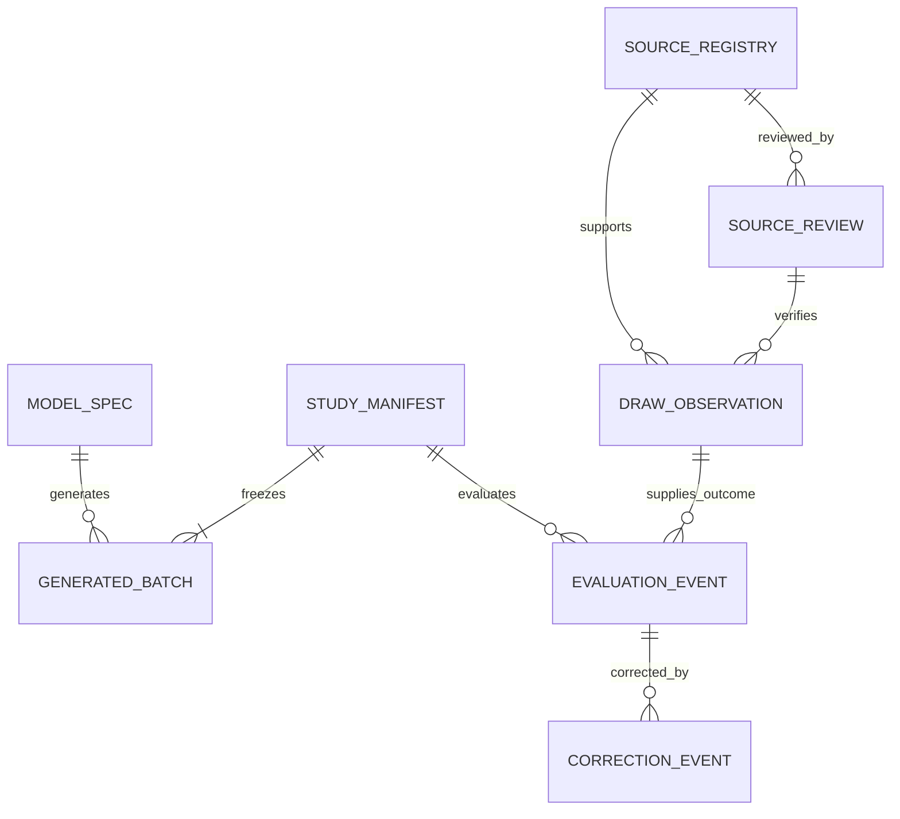

# Backend, Storage and Data Schema
<!-- @codebase_provenance_JEO -->

- **Status:** Proposed artifact schema and lifecycle; no database or backend is implemented
- **Baseline:** `origin/main` at `b67e31572187001c89266839871c9e28456b90e8`
- **Last reviewed:** 2026-10-17
- **Research verdict:** `STOP_NO_REPRODUCIBLE_PREDICTIVE_SIGNAL`

## Storage requirements and rationale

V1 uses versioned JSON for structured snapshots and JSONL for append-only event streams, reviewed through Git. This matches the proposed offline research engine and static read-only client without adding a service or database. The repository stores only public/approved research artifacts and synthetic fixtures; it does not store visitor-generated combinations.

| Store | Advantages | Limits | V1 decision |
| --- | --- | --- | --- |
| Git-versioned JSON/JSONL | Human review, diffs, immutable commit history, no database service, static hosting compatible | Concurrent writers require repository review; large histories are cumbersome; Git is not a query service | Use for bounded public artifacts and frozen studies |
| SQLite | Transactional local workflows and queries | Not a shared write store for a static site; adds migration/backup lifecycle | Defer unless local research operations show a need |
| PostgreSQL or managed database | Concurrent writes, query/index support, service controls | Requires backend/API, identity/access policy, operations, privacy and cost decisions | Out of v1; separate architecture approval required |

No database is required for browser-local generation or read-only artifact viewing. A migration seam is the artifact repository interface: `read_model`, `read_draw_series`, `write_frozen_manifest`, and `append_event`. These are proposed interface names only. Do not build an abstraction layer without an approved consumer.

## JSON and JSONL storage strategy

- Store each approved snapshot as UTF-8 JSON with a schema version and stable ID.
- Store immutable evaluation and correction events as one JSON object per JSONL line.
- Canonical hash input uses UTF-8, sorted object keys, normalized UTC timestamps, and no insignificant whitespace; line arrays use ascending ball order. Each object's own digest field is omitted from its hash preimage. For `StudyManifest`, the preimage is the complete frozen protocol and its model/batch references with only `manifest_sha256` and `timestamp_evidence` omitted; the TSA response is detached evidence that references this digest. `GeneratedBatch.batch_sha256` is computed with `batch_sha256` omitted.
- Record SHA-256 for source snapshots, model artifacts, generated batch files, and frozen study manifests.
- Do not update a frozen artifact in place. Create a new version/event referencing the previous ID and hash.
- Keep source data, synthetic fixtures, public display artifacts, and future outcomes in separate directories and access paths.
- Do not put credentials, visitor data, browser-local lines, or unapproved source extracts in Git.

## Logical entities and relationships



`SOURCE_REGISTRY` identifies a candidate source. `SOURCE_REVIEW` records separate access, reuse, privacy, and provenance decisions. `DRAW_OBSERVATION` is a normalized source record. `MODEL_SPEC` is immutable model/configuration metadata. `STUDY_MANIFEST` freezes a protocol and generated batches before a draw. `GENERATED_BATCH` is research-owned output, not visitor output. `EVALUATION_EVENT` is appended after the target draw. `CORRECTION_EVENT` and quarantine records preserve history.

## Stable requirements

| ID | Data requirement |
| --- | --- |
| DATA-001 | Every persisted record shall declare `schema_version`, `record_type`, and stable record ID. |
| DATA-002 | Source, model, study, batch, and event identifiers shall remain stable across corrections; changed facts create linked records/events. |
| DATA-003 | A verified `DrawObservation` shall have exactly six distinct integers from 1 through 42, one game, a validated draw date, and source evidence. |
| DATA-004 | Source access and reuse decisions shall be separate, reviewable, dated, and capable of expiry/revocation; collectors default disabled. |
| DATA-005 | `ModelSpec` shall bind algorithm, version, feature definition, training hash/cutoff, parameters, and fitting revision. |
| DATA-006 | `StudyManifest` shall freeze model/config hashes, registered output, target draw, endpoint definitions, and analysis plan before outcomes. |
| DATA-007 | `GeneratedBatch` shall identify research mode, model version, sample design, complete line set, and manifest. |
| DATA-008 | `EvaluationEvent` shall reference one frozen manifest and verified outcome source; it shall be append-only. |
| DATA-009 | Missing or unknown source values shall be JSON `null`, never fabricated, guessed, or encoded as empty strings or zero. |
| DATA-010 | Provenance shall identify source URLs/retrieval time/snapshot hash and reviewer status without claiming unverified authority. |
| DATA-011 | Historical training and future prospective outcomes shall use separate datasets and access controls; sealed validation/test data remain inaccessible. |
| DATA-012 | Quarantine and correction shall preserve the original record, reason, reviewer role, and successor reference. |
| DATA-013 | Frozen hashes shall cover canonical serialized bytes; RFC 3161 token and verification evidence shall bind to the manifest hash. |
| DATA-014 | No visitor-generated combination or profile shall be persisted centrally in v1. |

## Schema conventions

- Dates use ISO 8601 calendar date (`YYYY-MM-DD`); instants use UTC RFC 3339 (`YYYY-MM-DDThh:mm:ssZ`).
- Ball arrays contain six distinct integer values sorted ascending.
- Monetary values, if later included, use decimal strings plus currency codes; do not store floating-point currency.
- Unknown source fields use `null`. Empty string means a known empty text value only when the source explicitly provides it.
- `verification_status` and `reuse_status` are independent; a source may be official while machine access/reuse remains unapproved.
- Personal data are excluded by design. Reviewer identity uses a project role or approved reviewer ID; do not add personal details without a separate governance decision.

## DrawObservation schema

Required fields: `schema_version`, `record_type`, `draw_observation_id`, `record_class`, `game_id`, `draw_date`, `winning_numbers`, `verification_status`, `source_refs`, `retrieved_at`, and `created_at`. Nullable source values include jackpot amount and currency, jackpot winner count, source draw identifier, and source-provided publication time. The logical duplicate check uses a reviewed game/date/source draw key; it must not mutate the source file or treat repository row number as chronology.

`record_class` is `public_observation` or `synthetic_fixture`. `verification_status` is `synthetic`, `pending_review`, `verified`, `quarantined`, or `superseded`. Only `verified` observations from an approved source/reuse scope may appear in official-results views or authorized outcome evaluation.

## SourceRegistry, SourceReview, and provenance records

`SourceRegistry` fields: `source_id`, `schema_version`, `publisher_name`, `source_name`, `source_url`, `official_status` (`official`, `unverified`, or `third_party`), `access_method_status` (`not_reviewed`, `human_view_only`, `express_permission_required`, `approved`, or `denied`), `reuse_status` (`not_reviewed`, `permission_pending`, `approved`, or `denied`), `terms_url`, `collector_enabled`, `last_reviewed_at`, and `notes`. `collector_enabled` defaults to `false`; changing it requires a separately authorized deployment/operations action. `official_status=official` does not imply that access or reuse is approved.

`SourceReview` fields: `source_review_id`, `source_id`, `review_scope` (`identity`, `access`, `reuse`, `privacy`, or `provenance`), `decision` (`pending`, `approved`, `denied`, `expired`, or `needs_review`), `reviewed_at`, `reviewer_role`, `evidence_refs`, `conditions`, and nullable `expires_at`. Access and reuse must have separate decisions.

Provenance references include `source_id`, `source_url`, `retrieved_at`, nullable `source_published_at`, `source_snapshot_sha256`, `source_locator`, `review_status`, and `source_review_id`. Preserve raw source evidence only where lawfully obtained and approved; otherwise keep the source URL and review note without copying the content.

## ModelSpec schema

Required fields: `schema_version`, `record_type`, `model_id`, `model_version`, `algorithm_id` (`G0`, `G1`, `G2`), `status` (`baseline`, `experimental_control`, `pending_calibration`, `approved_for_experimental_use`, or `retired`), `feature_definition_version`, `training_dataset_sha256` or `null` for G0, `training_cutoff` or `null` for G0, `fit_revision`, `parameter_artifact_sha256`, `normalizer`, `sampler_contract_version`, `created_at`, and `review_refs`. G2 includes calibration method, regularization configuration, chronological fold definition, and approval status. G1 includes smoothing configuration and fixed-cardinality normalizer version. No unapproved parameters belong in a released model artifact.

## StudyManifest schema

Required fields: `schema_version`, `record_type`, `study_id`, `manifest_version`, `status`, `target_game_id`, `target_draw_date`, `target_draw_at_utc`, `target_draw_time_zone`, `frozen_at`, `protocol_version`, `model_refs`, `batch_refs`, `primary_endpoint`, `secondary_endpoints`, `multiplicity_policy`, `power_analysis_ref`, `stopping_rule`, `outcome_source_review_id`, `manifest_sha256`, `timestamp_evidence`, `created_at`, and `supersedes_manifest_id` (nullable). In `draft`, target time, freeze time, digest, timestamp evidence, and outcome-source review may be null; a non-confirmatory operations-only pilot may have a null power-analysis reference. Freezing requires a confirmed target UTC instant, nonempty model and batch references, a canonical digest, and a defined protocol. A confirmatory manifest also requires approved outcome-source review and a completed power/sensitivity reference. `timestamp_evidence` remains null until a verified TSA response is attached. `timestamp_evidence` identifies RFC 3161 TSA, token file/hash, verified imprint, token time, policy, signature status, and verifier/tool version. Registration is complete only after the token verifies and precedes `target_draw_at_utc`; static publication is a later state.

Lifecycle: `draft` → `frozen` → `timestamped` → `published` → `awaiting_outcome` → `evaluated`. `quarantined`, `withdrawn`, and `superseded` are terminal/non-editing states with a reference to the reason or successor. `frozen` has a canonical manifest hash but no timestamp token; `timestamped` requires a verified token. If the target draw is rescheduled before it occurs, do not silently edit the frozen manifest: create and timestamp a superseding manifest before the new target event. The external timestamp establishes time evidence for a hash, not validity of the model or data.

## GeneratedBatch schema

Required fields: `schema_version`, `record_type`, `batch_id`, `study_id`, `manifest_version`, `algorithm_id`, `model_version`, `config_sha256`, `sampling_mode` (`independent_with_replacement` or `distinct_sets`), `line_count`, `ticket_lines`, `generated_at`, `training_cutoff`, `software_revision`, `batch_sha256`, and `record_class` (`research_batch` or `synthetic_fixture`). `training_cutoff` is nullable for G0. `ticket_lines` is an array of `line_count` sorted six-integer lines; repeated complete lines are permitted only for `independent_with_replacement`. Lines are research-owned and only committed as part of a pre-draw frozen manifest. Visitor-generated lines are not `GeneratedBatch` records and are not uploaded.

## EvaluationEvent schema

Required fields: `schema_version`, `record_type`, `evaluation_event_id`, `study_id`, `manifest_version`, `manifest_sha256`, `target_draw_observation_id`, `evaluation_revision`, `metric_version`, `metrics`, `executed_at`, `software_revision`, and `event_status`. `metrics` distinguishes per-line match counts, full-combination hit indicator, log score, aggregate distribution metrics, and uncertainty summaries; only endpoints frozen in the manifest may be confirmatory. Missing observations remain pending; they are not replaced with guessed values.

## Field-level type and nullability constraints

The tables define the v1 JSON contract at the field level. “Required” means the key is present; state-dependent `null` is explicitly described. Unknown source values use JSON `null`.

### DrawObservation

| Field | JSON type | Constraint |
| --- | --- | --- |
| `schema_version`, `draw_observation_id`, `game_id` | string | Required; stable ID, supported game ID `lotto-6-42` |
| `record_type` | string | Literal `DrawObservation` |
| `record_class` | string | `public_observation` or `synthetic_fixture` |
| `draw_date` | string | ISO date `YYYY-MM-DD`; verified only after source review |
| `winning_numbers` | integer array | Exactly 6 distinct values in 1..42, ascending canonical order |
| `jackpot_amount` | string or null | Decimal string; paired with currency; null when source omits it |
| `jackpot_currency` | string or null | ISO currency code from source; null if amount is unknown |
| `jackpot_winner_count` | integer or null | Nonnegative source value; null when absent, never inferred |
| `source_draw_id`, `source_published_at` | string or null | Source identifier and UTC RFC 3339 instant when provided |
| `verification_status` | string | `synthetic`, `pending_review`, `verified`, `quarantined`, or `superseded` |
| `source_refs` | array of objects | Empty only for synthetic fixtures; public records require provenance reference(s) |
| `retrieved_at` | string or null | UTC RFC 3339; null only for synthetic/offline fixture |
| `created_at` | string | UTC RFC 3339 record-creation instant |

Each `source_refs` object contains `source_id` and `source_url` strings, `retrieved_at` UTC string, nullable `source_published_at`, nullable `source_snapshot_sha256`, nullable `source_locator`, `review_status`, and `source_review_id`. `source_snapshot_sha256` is null when retaining a source copy is not permitted; do not copy content solely to populate it.

### SourceRegistry and SourceReview

| Field | JSON type | Constraint |
| --- | --- | --- |
| `source_id`, `source_review_id` | string | Stable IDs; present on their respective records |
| `schema_version` | string | Required on each record |
| `record_type` | string | Literal `SourceRegistry` or `SourceReview` |
| `publisher_name`, `source_name`, `source_url` | string | Required; identity claims remain reviewable |
| `official_status` | string | `official`, `unverified`, or `third_party`; does not imply reuse approval |
| `access_method_status` | string | `not_reviewed`, `human_view_only`, `express_permission_required`, `approved`, or `denied` |
| `reuse_status` | string | `not_reviewed`, `permission_pending`, `approved`, or `denied` |
| `terms_url` | string or null | Null when no terms URL is verified |
| `collector_enabled` | boolean | Defaults to false; activation requires separate approval |
| `last_reviewed_at` | string or null | UTC RFC 3339; null until source review occurs |
| `review_scope` | string | `identity`, `access`, `reuse`, `privacy`, or `provenance` |
| `decision` | string | `pending`, `approved`, `denied`, `expired`, or `needs_review` |
| `reviewed_at`, `expires_at` | string or null | UTC RFC 3339; `reviewed_at` null only while pending |
| `reviewer_role` | string | Role/approved reviewer ID; no personal profile fields |
| `evidence_refs`, `conditions` | arrays | Evidence references and explicit restrictions; empty for unreviewed record |

### ModelSpec, StudyManifest, GeneratedBatch, and EvaluationEvent

| Field | JSON type | Constraint |
| --- | --- | --- |
| `model_id`, `model_version`, `feature_definition_version`, `fit_revision`, `sampler_contract_version` | string | Stable/model-version strings; G0 may use fixed contract IDs |
| `algorithm_id` | string | `G0`, `G1`, or `G2` |
| `status` | string | Model lifecycle enum defined above; G2 is not exposed while pending calibration |
| `training_dataset_sha256`, `training_cutoff` | string or null | Null for G0 and unfit candidates; required for a released trained model |
| `parameter_artifact_sha256` | string or null | Null for G0 or pending/unfitted candidate; required for released G1/G2 |
| `normalizer` | string or object | Versioned normalizer ID/config; synthetic placeholder only in synthetic fixture |
| `review_refs` | string array | Required; at least one approval reference for released G1/G2 |
| `study_id`, `batch_id`, `evaluation_event_id` | string | Stable IDs on respective records |
| `manifest_version`, `evaluation_revision`, `line_count` | integer | Positive integer; `line_count` equals `ticket_lines` length |
| `target_game_id`, `target_draw_date`, `target_draw_time_zone` | string | Game ID, ISO date, IANA time-zone name |
| `target_draw_at_utc`, `frozen_at` | string or null | RFC 3339 UTC; null only in draft state |
| `created_at`, `generated_at`, `executed_at` | string | RFC 3339 UTC; required for every non-draft research record |
| `protocol_version`, `primary_endpoint`, `metric_version`, `software_revision` | string | Immutable version/identifier references |
| `secondary_endpoints`, `model_refs`, `batch_refs` | arrays | Frozen, versioned references; batch/model arrays must be nonempty when frozen |
| `multiplicity_policy`, `stopping_rule` | string or object | Frozen, explicit protocol definitions |
| `power_analysis_ref`, `outcome_source_review_id` | string or null | Confirmatory manifest requires both resolved and approved |
| `manifest_sha256`, `config_sha256`, `batch_sha256` | string or null | Lowercase 64-hex SHA-256; null only before freeze/synthetic fixture |
| `timestamp_evidence` | object or null | Detached verified RFC 3161 evidence; required in timestamped and later states |
| `sampling_mode` | string | `independent_with_replacement` or `distinct_sets` |
| `ticket_lines` | array of integer arrays | Each line has six unique in-range ascending balls |
| `metrics` | object | Versioned named metrics; includes value, denominator/sample count, and uncertainty or explicit null where applicable |
| `event_status` | string | `pending_source`, `evaluated`, or `quarantined`; missing outcome remains pending |

### CorrectionEvent and QuarantineRecord

Both records include `schema_version`, `record_type`, stable event ID, `entity_type`, `entity_id`, `record_sha256`, `reason_code`, `evidence_refs` array, role attribution, and UTC `created_at`. `CorrectionEvent` additionally requires `successor_record_id`; `QuarantineRecord` requires `release_condition` and `disposition` (`open`, `released`, or `retained_quarantined`). No correction changes the prior object in place.

## Correction and quarantine records

`CorrectionEvent` is append-only and contains `schema_version`, `record_type`, `correction_event_id`, `entity_type`, `entity_id`, `prior_record_sha256`, `reason_code`, `evidence_refs`, `reviewer_role`, `created_at`, and `successor_record_id`. `QuarantineRecord` contains `schema_version`, `record_type`, `quarantine_id`, `entity_type`, `entity_id`, `record_sha256`, `reason_code`, `evidence_refs`, `detected_by_role`, `created_at`, `release_condition`, and `disposition` (`open`, `released`, or `retained_quarantined`). The original object remains retrievable and marked `superseded` or `quarantined`; no silent overwrite is permitted. Do not expose unsupported/uncertain observations as verified.

## Clearly labelled synthetic schema examples

Every example below is synthetic test data. It is not an official draw, actual registered batch, model result, timestamp proof, or experimental finding.

### Synthetic DrawObservation fixture

```json
{
  "schema_version": "1.0",
  "record_type": "DrawObservation",
  "draw_observation_id": "syn-draw-0001",
  "record_class": "synthetic_fixture",
  "game_id": "lotto-6-42",
  "draw_date": "2030-01-01",
  "winning_numbers": [2, 8, 14, 23, 31, 42],
  "jackpot_amount": null,
  "jackpot_currency": null,
  "jackpot_winner_count": null,
  "source_draw_id": null,
  "source_published_at": null,
  "verification_status": "synthetic",
  "source_refs": [],
  "retrieved_at": null,
  "created_at": "2030-01-02T00:00:00Z"
}
```

### Synthetic ModelSpec fixture

```json
{
  "schema_version": "1.0",
  "record_type": "ModelSpec",
  "model_id": "syn-model-g2",
  "model_version": "0.0.0-synthetic",
  "algorithm_id": "G2",
  "status": "pending_calibration",
  "feature_definition_version": "synthetic-features-v1",
  "training_dataset_sha256": null,
  "training_cutoff": null,
  "fit_revision": "synthetic-fixture-only",
  "parameter_artifact_sha256": null,
  "normalizer": "synthetic-placeholder",
  "sampler_contract_version": "synthetic-v1",
  "created_at": "2030-01-02T00:00:00Z",
  "review_refs": []
}
```

### Synthetic StudyManifest fixture

```json
{
  "schema_version": "1.0",
  "record_type": "StudyManifest",
  "study_id": "syn-study-0001",
  "manifest_version": 1,
  "status": "draft",
  "target_game_id": "lotto-6-42",
  "target_draw_date": "2030-02-01",
  "target_draw_at_utc": null,
  "target_draw_time_zone": "Asia/Manila",
  "frozen_at": null,
  "protocol_version": "synthetic-protocol-v1",
  "model_refs": [],
  "batch_refs": [],
  "primary_endpoint": "synthetic-only",
  "secondary_endpoints": [],
  "multiplicity_policy": "synthetic-only",
  "power_analysis_ref": null,
  "stopping_rule": "synthetic-only",
  "outcome_source_review_id": null,
  "manifest_sha256": null,
  "timestamp_evidence": null,
  "created_at": "2030-01-02T00:00:00Z",
  "supersedes_manifest_id": null,
  "record_class": "synthetic_fixture"
}
```

The examples intentionally use `null` for unknown source values and absent evidence. Their future dates and synthetic IDs are fixture markers, not actual records.

## Schema versions and stable identifiers

Use explicit semantic schema versions. Additive optional fields may remain in a compatible minor version only after consumers are tested. Breaking field meaning/type, enum, canonicalization, or lifecycle changes require a new major schema version. Preserve stable IDs when a record is corrected; link the successor. Never reuse a deleted ID. Persist schema migration provenance and old hashes. Avoid generating identifiers from mutable row positions.

## Data validation and deduplication

Validate JSON schema, types, nullability, game ID, six-ball uniqueness/range/sorted canonical form, ISO date, source refs, hashes, and lifecycle transitions. Deduplicate only against a reviewed logical game/draw key and source evidence. Conflicts go to quarantine for human adjudication. Keep `source_row` as original provenance metadata and enforce its uniqueness where applicable; chronological order is checked by `draw_date`, not `source_row`. Do not rewrite or reorder source datasets.

## Training and prospective dataset isolation

Historical development may use only approved training data. The currently documented training boundary is 902 records, 2016-08-30 through 2022-11-12. Validation and locked-test records are sealed and outside Phase 8 access. Future prospective outcomes reside in a separate path and identifier namespace and are read only after the manifest timestamp and target draw. Outcomes from a registered study cannot be used to tune that frozen study. Any later training use requires a new protocol, data permission, and artifact version; this proposal does not authorize it.

## Data lifecycle and correction handling

1. Source candidate is entered with collection disabled and access/reuse decisions pending.
2. Source reviews are recorded separately for identity, access, reuse, privacy, and provenance.
3. A future authorized observation is captured with provenance and validated.
4. Uncertain, conflicting, or incomplete records remain pending/quarantined; missing fields use `null`.
5. Approved records are committed as versioned artifacts after review.
6. A source correction creates an append-only correction event and a successor record.
7. Frozen manifests and evaluation events are immutable; corrections link to prior hashes.
8. Retention/removal policy for public-source copies is decided after rights review; no assumption of perpetual reuse is made.

## Immutable research artifacts

Model specifications, parameter files, frozen manifests, registered batch lines, timestamp tokens, and evaluation events are content-addressed by SHA-256 and versioned. A new version does not erase earlier versions. Repository history supports review but does not itself prove pre-draw existence. The RFC 3161 token is independently verified against the canonical manifest hash. Store token bytes, request/response metadata, TSA certificate chain/status, policy OID, trusted UTC time, verification result, and verifier version. RFC 3161 describes time-stamping tokens as evidence that data existed by a particular time; it does not certify underlying truth.

## Timestamp and hash verification

Before a target draw:

1. Freeze all model/config/batch/output references and the analysis protocol.
2. Canonicalize the complete `StudyManifest` and registered batches.
3. Calculate SHA-256 over the canonical bytes and cross-check referenced artifact hashes.
4. Submit only the hash imprint to a selected independent RFC 3161 TSA.
5. Verify the returned token's signature/certificate status, imprint algorithm/value, policy, nonce when used, and trusted time using an approved verifier.
6. Confirm the token time precedes the declared target draw time in its stated time zone.
7. Commit the manifest, token, and verification record; publish a read-only static view when deployment is approved.

If any verification step fails or occurs after the draw, do not label the study preregistered. Re-freezing requires a new manifest; do not alter a timestamped manifest.

## Storage abstraction and migration options

The proposed artifact interface isolates stable logical operations from storage format. JSON/JSONL in Git is adequate while updates are low-volume, reviewed, append-only, and public. If concurrent writes, query volume, retention control, or access management make it inadequate, compare SQLite for local-only operations with managed PostgreSQL for shared service workloads. A database migration requires new authorization, schema/backfill plan, access controls, privacy/security review, backups, and reproducible reconciliation against source hashes. No database is created in Phase 8 planning.

## Privacy and access boundaries

No visitor combinations, account data, or personal profiles are persisted centrally in v1. Do not create analytics records of numbers generated. Public research outputs contain project-owned batches only. Hosting provider request logs are an external operational data flow and need provider-specific notice/retention review. Reviewer names/contact details are not part of public artifacts unless explicitly approved; use project-role attribution where possible. Secrets and TSA credentials never enter tracked artifacts.

## Source feasibility matrix

Checked 2026-10-17 using primary public materials. Status is a planning assessment, not legal advice or authorization.

| Candidate | Identity/result access evidence | Automated access | Reuse status | Decision |
| --- | --- | --- | --- | --- |
| PCSO official website results page | Official PCSO-domain search result identifies a results page; direct page was inaccessible in the live page-open check. No public machine-readable API or documented feed was confirmed. | `NOT_VERIFIED`; do not assume API, scrape, or bypass controls | `NOT_REVIEWED`; source terms/reuse scope not confirmed | Candidate for official-source inquiry. Manual or automated ingestion and republication remain blocked pending access/reuse review |
| PCSO 2025 Citizen's Charter | Official PCSO PDF exists and references PCSO public information/result service processes; it does not by itself document a public API or third-party reuse grant | Not applicable | Does not establish reuse permission | Context only; obtain source-specific written guidance |
| LottoMatik results page | Current results page is public; current Terms identify DFNN/partners and describe the site's relationship with PCSO | Current terms prohibit crawler/spider/scraper or other automated access absent express written permission; they prohibit bypassing access restrictions | Current terms restrict copying/distribution/reproduction/derivative works without express permission | `BLOCKED_PENDING_EXPRESS_PERMISSION`; no scraping or public copying |
| Other third-party results sites | No source-specific review in this proposal | Unknown | Unknown | Not approved; do not ingest by default |

Primary sources: [PCSO official results page](https://www.pcso.gov.ph/?content=hasil), [PCSO Citizen's Charter](https://www.pcso.gov.ph/pcsofiles/transparency/2025%20PCSO%20Citizen%27s%20Charter%202nd.pdf), [LottoMatik results](https://lottomatik.pcso.gov.ph/lotto-results), [LottoMatik Terms](https://lottomatik.pcso.gov.ph/terms), and [RFC 3161](https://www.rfc-editor.org/info/rfc3161/). The direct PCSO page did not load during review; the result-page listing was discoverable in search, but its machine access and reuse terms are unverified. LottoMatik terms checked on the date above expressly reserve automated access and copying/reuse pending permission. Obtain written confirmation and governance review before activation.
